# ha-dashboard-header

[](https://www.home-assistant.io/integrations/marketplace/)
[](https://github.com/juju35/ha-dashboard-header/actions/workflows/hacs.yml)
[](https://github.com/juju35/ha-dashboard-header/actions/workflows/validate.yml)
[](https://github.com/juju35/ha-dashboard-header/actions/workflows/lint.yml)
[](https://github.com/juju35/ha-dashboard-header/releases/latest)
[](https://github.com/juju35/ha-dashboard-header/blob/main/LICENSE)
[](https://buymeacoffee.com/julienstep9)

<p align="center"></p>

**Illustrated headers for your Home Assistant dashboards**, in the style of the ha-* cards: each dashboard gets a 90 px scene (a house, devices, cars, energy, a server rack, security, family, a terrace, a garden, a pool, a veranda, the entrance and every room of the house) that follows the state of your home, with its title, a live subtitle, a status pill and calm text tabs — or a compact bar with pill tabs. Light and dark, with day and night scenes.

| Light | Dark |
|---|---|
| 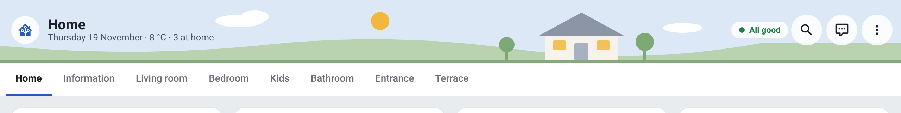 |  |

## Features

- **Twenty-one scenes**, one per kind of dashboard: `maison`, `equipements`, `voitures`, `energie`, `systeme`, `securite`, `famille`, `exterieur` (English names work too: `home`, `devices`, `cars`, `energy`, `system`, `security`, `family`, `outdoor`).
- **Rooms, entrances, garden, pool and veranda**: `living_room`, `kitchen`, `dining_room`, `bathroom`, `toilet`, `bedroom`, `nursery`, `kids_room`, `teen_room`, `garage`, `hallway`, `office`, `laundry`, `game_room`, `guest_room`, `home_cinema`, `gym`, `workshop`, `cellar`, `attic`, `entrance` (outside), `entryway` (inside), `garden`, `pool`, `veranda` (their French names work too: `salon`, `cuisine`, `salle_a_manger`, `chambre_d_amis`, `cinema`, `salle_de_sport`, `atelier`, `cave`, `grenier`, `salle_de_bain`, `toilettes`, `chambre_parents`, `chambre_bebe`, `chambre_enfant`, `chambre_ado`, `couloir`, `bureau`, `buanderie`, `salle_de_jeux`, `entree`, `entree_interieure`, `jardin`, `piscine`, `veranda`; spaces and accents are fine: `Salle de bain`, `chambre bébé`).
- **The scene follows your home**: lit windows when the lights are on, the robot vacuum leaving its dock, the meter showing today's Tempo color, a blinking LED on the server rack, the alarm shield turning red, rain on the terrace… (`scene_state`, any entity or template).
- **Live title, subtitle and status pill** from entities or templates, rendered by Home Assistant.
- **Two modes**: `illustrated` (band + text tabs) or `compact` (one bar, pill tabs) — or `auto`: illustrated on a computer, compact on a phone. The illustrated header **folds to the compact bar when you scroll**, and unfolds at the top.
- **Day and night**: the scene follows the Home Assistant theme (dark theme = night), or is forced with `illustration_theme`.
- **Nothing native is lost**: Home Assistant's own toolbar stays — sidebar button, search, Assist and the dashboard menu work as before, restyled as round buttons. Edit mode and dashboards without the option keep the native header.
- **Per view**: a view can change the scene, the subtitle, the status… or turn the header off.
- **Subviews**: the header follows into subviews, with a back button (Home Assistant's own, `back_path` included), the subview's title and icon, and the dashboard's title as a breadcrumb.
- **App panels too**: add-on pages of the sidebar (Terminal & SSH, File editor…) can get a banner above the app.
- **Energy panel**: a layout per tab — grid, gas and water today; the Linky in its Tempo color with solar panels and battery; live power running to the house.
- Phones: the scene moves under the buttons, the status becomes a dot, tabs scroll.
- Designed for the [ha-neutral](https://github.com/juju35/ha-neutral) theme, works with any theme.

## Prerequisites

Home Assistant 2025.6 or later.

## Installation

### Via the Marketplace (recommended)

Click the button below to add the repository directly:

[](https://my.home-assistant.io/redirect/marketplace_repository/?owner=juju35&repository=ha-dashboard-header&category=plugin)

Then click **Install**, and reload your browser when the Marketplace asks you to.

Or manually:

1. Open **Settings → Marketplace → Add from link** (top right; this needs a GitHub account connected)
2. Add `https://github.com/juju35/ha-dashboard-header` — Type: **Dashboard**
3. Open **Dashboard Header** and click **Install**
4. Clear your browser cache and refresh

The Marketplace adds the resource `/local/community/ha-dashboard-header/dashboard-header.js` for you.

### Manual

1. Download `dashboard-header.js` from the [latest release](https://github.com/juju35/ha-dashboard-header/releases/latest)
2. Copy it to `/config/www/`
3. Go to **Settings → Dashboards → ⋮ → Resources** → Add resource:
   - URL: `/local/dashboard-header.js`
   - Type: **JavaScript Module**
4. Clear your browser cache and refresh

## Configuration

The header is set per dashboard, at the top level of the dashboard's YAML (**Edit dashboard → ⋮ → Raw configuration editor**), next to `views:`. A dashboard without `dashboard_header:` keeps the native header.

### Minimal

```yaml
dashboard_header:
  scene: maison
views:
  - title: Home
    # …
```

### A full example

```yaml
dashboard_header:
  scene: maison
  mode: illustrated            # or compact, or auto (compact on phones)
  collapse_on_scroll: true     # fold to the compact bar when scrolling
  title: Home                  # default: the dashboard's title
  subtitle: >-
    {{ now().strftime('%A %-d %B') }} · {{ states('sensor.outdoor_temperature') }} °C ·
    {{ states.person | selectattr('state', 'eq', 'home') | list | count }} at home
  status:
    text: "{{ 'All good' if is_state('binary_sensor.problems', 'off') else 'Check' }}"
    color: "{{ 'green' if is_state('binary_sensor.problems', 'off') else 'red' }}"
  scene_state:
    lights: light.all_lights
views:
  - title: Home
  - title: Garage
    dashboard_header:          # this view only
      scene: voitures
      scene_state:
        vehicles: [image.suv_picture, image.city_car_picture]
  - title: Terrace
    dashboard_header:
      scene: exterieur
      scene_state:
        rain: binary_sensor.rain_next_hour
        lamp: light.terrace
```

### Options reference

| Option | Default | Description |
|---|---|---|
| `scene` | `maison` | The illustration: `maison`, `equipements`, `voitures`, `energie`, `systeme`, `securite`, `famille`, `exterieur`, a room (`living_room`, `kitchen`, `dining_room`, `bathroom`, `toilet`, `bedroom`, `nursery`, `kids_room`, `teen_room`, `garage`, `hallway`, `office`, `laundry`, `game_room`, `guest_room`, `home_cinema`, `gym`, `workshop`, `cellar`, `attic`), `entrance`, `entryway`, `garden`, `pool`, `veranda`, or `none` (band without a picture). English and French aliases accepted. |
| `mode` | `illustrated` | `illustrated` (90 px band and text tabs), `compact` (64 px bar, pill tabs) or `auto` (compact where Home Assistant lays the page out for a phone, illustrated elsewhere; follows rotation and resizing). |
| `compact_below` | — | With `mode: auto`: switch to compact under this window width, in px (e.g. `600`), instead of Home Assistant's phone layout. |
| `collapse_on_scroll` | `true` | Illustrated mode: fold to the compact bar once the page scrolls, unfold at the top. |
| `title` | dashboard title | Text, entity id or template. |
| `subtitle` | — | Text, entity id or template. |
| `icon` | per scene | MDI icon of the badge, e.g. `mdi:home-assistant`. |
| `accent` | per scene | Badge, active tab and default status color: a palette name (`green`, `amber`, `blue`, `cyan`, `violet`, `red`, `gray`) or any CSS color. |
| `status.text` | — | Status pill text: text, entity id or template. No pill without it. |
| `status.entity` | — | Show this entity's state as the status text (instead of `status.text`). |
| `status.color` | accent | Pill color: palette name, CSS color or template. |
| `scene_state` | — | What the scene shows: see below. Each value is an entity id, a template or a literal. |
| `illustration_theme` | theme | `day` or `night` to force the scene; by default dark theme = night. |
| `enabled` | `true` | In a view's block: `false` keeps the native header on that view. |
| `subviews` | `true` | Dashboard block: `false` keeps the native header on subviews (a subview with its own block still gets the banner). See [Subviews](#subviews). |
| `panels` | — | Dashboard block only: header blocks of app panels and of the Energy panel by URL path, see [App panels](#app-panels-add-ons) and [Energy panel](#energy-panel). |

Every option can be set again in a view's own `dashboard_header:` block; it overlays the dashboard's block (`scene_state` and `status` are merged key by key).

### Subviews

A subview (`subview: true`) gets the banner too, without tabs (Home Assistant shows none there). A back button takes the place of the sidebar button: it is Home Assistant's own, so `back_path` keeps working. The title is the subview's, its `icon` replaces the scene's, and the dashboard's title shows as the subtitle. A subview may have its own `dashboard_header:` block like any view:

```yaml
views:
  - title: Living room lights
    path: living-room-lights
    subview: true
    back_path: /dashboard-home/living-room
    icon: mdi:sofa
    dashboard_header:
      subtitle: "{{ states.light | selectattr('state', 'eq', 'on') | list | count }} on"
```

Set `subviews: false` in the dashboard's block to keep the native header on its subviews.

### App panels (add-ons)

App pages opened from the sidebar (add-on ingress, e.g. **Terminal & SSH** at `/core_ssh`) have no YAML of their own. List them by their URL path under `panels:` in the `dashboard_header:` block of any dashboard; each entry takes the same options as a dashboard block (no tabs, no folding):

```yaml
dashboard_header:
  scene: maison
  panels:
    core_ssh:                  # the path after the address: /core_ssh
      scene: systeme
      mode: compact            # leaves the most room to the app
      title: Terminal
      subtitle: "{{ states('sensor.processor_use') }} % CPU"
views:
  # …
```

The banner sits above the app's frame and takes the place of the panel's small header (its sidebar button is drawn in the banner); the app keeps the rest of the height. A dashboard that only holds the list can keep its native header with `enabled: false`. In kiosk mode the app page is left untouched.

A dashboard resource is only loaded once a dashboard has been opened. For the banner to show when an app page is opened first (a bookmark, a reload), load the file on every page too, in `configuration.yaml`:

```yaml
frontend:
  extra_module_url:
    - /local/community/ha-dashboard-header/dashboard-header.js
```

The dashboard resource can stay: the second copy does nothing. The `panels:` lists are read once per page load, from every dashboard of the sidebar, and again after a dashboard is edited.

### Energy panel

The built-in **Energy** panel (`/energy`) is drawn by the same dashboard root, so it gets the full banner — its own tabs (Overview, Electricity, Now…), Home Assistant's buttons, folding on scroll. Its configuration is generated, so its block goes in the `panels:` list under `energy`, with a block per tab under `views:` (keyed by the tab's path: `overview`, `electricity`, `gas`, `water`, `now`). The `energie` scene has a layout per tab:

```yaml
dashboard_header:
  panels:
    energy:
      scene: energie
      title: Energy
      views:
        overview:
          subtitle: "{{ states('sensor.energy_today') }} kWh today"
          scene_state:
            layout: overview
            electricity: sensor.energy_today
            gas: sensor.gas_today
            water: sensor.water_today
        electricity:
          icon: mdi:home-lightning-bolt
          status: { entity: sensor.tempo_today, color: blue }
          scene_state:
            layout: electricity
            tempo: sensor.tempo_today
            period: sensor.tariff_period
            solar: sensor.solar_power
            battery: sensor.battery_level
        now:
          icon: mdi:flash
          status: { entity: sensor.house_power, color: amber }
          scene_state:
            layout: now
            grid: sensor.grid_power
            solar: sensor.solar_power
```

The `panels:` lists are read when the panel opens (see [App panels](#app-panels-add-ons)); no `extra_module_url` is needed for the Energy panel when the resource is loaded, but it helps when `/energy` is the first page opened.

### Scene states

| Scene | Key | Shows |
|---|---|---|
| `maison` | `lights` | Lit windows when on. |
| `equipements` | `vacuum` | The robot leaves its dock and sweeps while `cleaning` / `returning`. |
| | `appliance` | A programme bar runs on the dishwasher when on. |
| | `printer` | The printer LED blinks red when on (an alert). |
| `voitures` | `vehicles` | The cars parked on the road, up to three: a list of picture entities (the `image.*` entity of the car's integration or of [ha-renault-picture](https://github.com/juju35/ha-renault-picture), a device tracker with a picture) or picture URLs, each drawn as the car's own picture as in [ha-vehicle-card](https://github.com/juju35/ha-vehicle-card); or a number of plain cars (default 2). An item can be an object `{ picture, home, low }`: `home` (a device tracker, a binary sensor or a template) says whether the car is at home, `low` whether its tank is low. |
| | `layout` | `road` (default), `driveway` — the cars on the driveway of the house, a car away leaves its spot empty —, or `station` — a price totem, the car with a low tank at the pump. A template can switch it (e.g. `station` when a range drops low). |
| | `prices` | Station layout: up to two prices for the totem, `{ label: entity / template / value }`, e.g. `{ Diesel: sensor.cheapest_diesel }`. |
| `energie` | `tempo` | The meter's screen in today's Tempo color (`bleu`/`blue`, `blanc`/`white`, `rouge`/`red`). |
| | `power` | The meter's bolt pulses when on. |
| | `layout` | `overview`, `electricity` or `now`: the layouts made for the Energy panel's tabs (below); the meter between two pylons otherwise. |
| | `electricity`, `gas`, `water` | Overview: today's use, shown with its unit over the grid line, the gas meter and the water tap. The gas meter and the tap only show when given. |
| | `tempo`, `period` | Electricity: the Linky on the wall in today's Tempo color; both shown as text over the pylon (e.g. `Blue · HC`). |
| | `solar` | Electricity: panels on the roof (a power above 0 or "on"). Now: the panels' output, running to the house. |
| | `battery` | Electricity: a home battery filled to its charge (%), red under 20 %, amber under 50 %. |
| | `grid` | Now: power drawn from the grid, running from the pylon to the house; a negative value (export) runs back, in green. |
| | `total` | Now: the house's power on its roof; by default `grid` + `solar`. |
| | `lights` | Overview and electricity: lit windows (lit by default). |
| `systeme` | `alert` | One rack LED blinks amber (`warning`, or any "on" state) or red (`error`, `critical`). |
| `securite` | `alarm` | The shield: green when armed, amber pending, red flashing when triggered, gray disarmed. |
| | `lock` | The door LED: green locked, amber unlocked, red open or jammed. |
| | `camera_privacy` | The camera LED turns violet when on. |
| `famille` | `school` | The school flag is up when on, down when off. |
| | `bin` | A bin in the collection's color (`jaune`/`yellow`, `vert`/`green`, `bleu`/`blue`, `marron`/`brown`, `gris`/`gray` or a CSS color); none when empty or off. |
| `exterieur` | `rain` | Rain falls from the cloud when on. |
| | `lamp` | The terrace lamp is lit when on. |
| `bathroom` | `light` | The ceiling light is on. |
| | `humidity` | Steam rises over the bath from 70 % (or when on). |
| | `fan` | The extractor fan turns when on. |
| `toilet` | `light`, `fan` | Ceiling light on, extractor fan turning. |
| | `occupied` | The door sign turns red (occupied) or green (free). |
| `bedroom` | `lights` | The bedside lamps are lit. |
| | `shutter` | The roller shutter: a cover position (100 = open) or `open` / `closed`. |
| | `sleep` | "zZ" rise over the bed when on. |
| `nursery` | `night_light` | The night light glows on the dresser. |
| | `sleep` | "zZ" rise over the crib. |
| | `music` | The mobile sways over the crib. |
| `kids_room` | `lights`, `sleep`, `shutter` | Ceiling light and star lamp, "zZ" over the bed, the roller shutter. |
| `teen_room` | `lights` | The ceiling light is on. |
| | `pc` | The screen and the PC's LEDs light up. |
| | `led` | The LED strip along the ceiling in this color (a palette name or CSS color; violet when simply on). |
| `garage` | `door` | The sectional door raised to its position (`open`, `closed`, `opening` / `closing` pulsing, or a cover position). |
| | `car` | The car inside (default), or its empty spot when off. |
| | `light` | The ceiling light is on. |
| `hallway` | `lights` | The ceiling lights and the console lamp are lit. |
| | `motion` | The motion sensor blinks red. |
| | `door` | The room door is ajar when on. |
| `office` | `pc` | Both screens light up. |
| | `lamp` | The desk lamp is lit. |
| | `busy` | The "ON AIR" light turns red during a call. |
| `laundry` | `washer`, `dryer` | The drum turns and a programme bar runs while on. |
| `entrance` | `light` | The porch light and the windows are lit. |
| | `door` | The front door is open. |
| | `doorbell` | The doorbell rings when on. |
| | `mailbox` | The letterbox flag is up when on. |
| | `parcel` | A parcel waits on the doorstep. |
| `entryway` | `lights` | The ceiling light is on. |
| | `lock` | The lock LED: green locked, amber unlocked, red open or jammed. |
| | `alarm` | The keypad LED: green armed, amber blinking pending, red triggered, gray disarmed. |
| | `door` | The front door is open. |
| `garden` | `watering` | The sprinkler sprays when on. |
| | `mower` | The robot mower leaves its station while mowing. |
| | `lights` | The garden lamps are lit. |
| `pool` | `pump` | Ripples run on the water while the filtration pump runs. |
| | `light` | The pool light glows under the water. |
| | `heater` | The heat pump's fan turns and its LED is amber. |
| | `cleaner` | The robot cleaner crosses the bottom of the pool. |
| | `cover` | The cover rolled over the water to its closed share (`open`, `closed`, or a cover position, 100 = open). |
| `game_room` | `lights` | The long lamp over the pool table is lit. |
| | `tv` | The TV screen lights up. |
| | `arcade` | The arcade cabinet's screen lights up. |
| | `neon` | The "PLAY" neon sign in this color (a palette name or CSS color; violet when simply on). |
| `living_room` | `lights` | The floor lamp is lit. |
| | `tv` | The TV lights up. |
| | `shutter` | The window's roller shutter. |
| `kitchen` | `lights` | The lights under the wall cabinets are on. |
| | `cooking` | The hob is on, steam rises over the pan. |
| | `oven` | The oven is lit inside. |
| | `hood` | The hood's fan turns. |
| | `dishwasher` | A programme bar runs on the dishwasher. |
| `dining_room` | `lights` | The pendant lamp and the candle are lit. |
| | `shutter` | The window's roller shutter. |
| `cellar` | `lights` | The bare bulb is lit. |
| | `humidity` | Drops bead on the walls from 70 % (or when on). |
| | `water_heater` | Heat rises over the water heater and its LED is amber. |
| | `leak` | A puddle on the floor, the leak sensor blinks red. |
| `attic` | `lights` | The bulb under the roof is lit. |
| | `skylight` | The roof window's shutter, down to its closed share. |
| `guest_room` | `lights` | The bedside lamp is lit. |
| | `shutter` | The window's roller shutter. |
| | `occupied` | A suitcase beside the bed when a guest is staying. |
| | `sleep` | "zZ" rise over the bed. |
| `home_cinema` | `projector` | A film on the screen and the projector's beam. |
| | `lights` | The wall sconces are lit. |
| | `sound` | Sound waves come out of the speaker. |
| `gym` | `treadmill` | The treadmill's belt runs and its screen lights up. |
| | `fan` | The standing fan turns. |
| | `lights` | The ceiling lights are on. |
| `workshop` | `lights` | The shop lamp is on. |
| | `printer` | The 3D printer's head moves and the part grows. |
| | `saw` | The table saw's blade turns. |
| `veranda` | `blinds` | The roof blinds drawn to their closed share (`open`, `closed`, or a cover position, 100 = open). |
| | `lights` | The hanging lights are lit. |
| | `fan` | The ceiling fan turns. |

"On" means `on`, `true`, `open`, `home`, `cleaning`, `running`, `armed_*`, a number above 0…

## Screenshots

### Scenes

| Light | Dark |
|---|---|
| 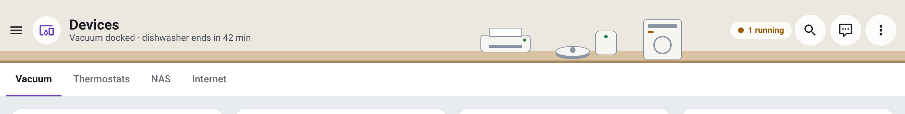 |  |
|  |  |
| 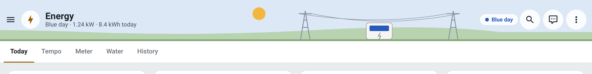 | 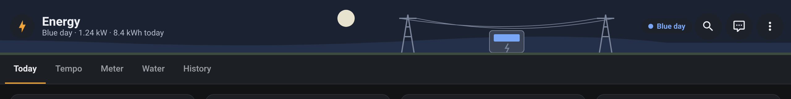 |
|  |  |
|  |  |
| 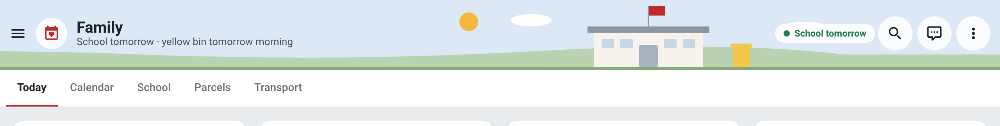 |  |
|  | 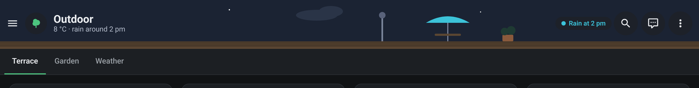 |
| 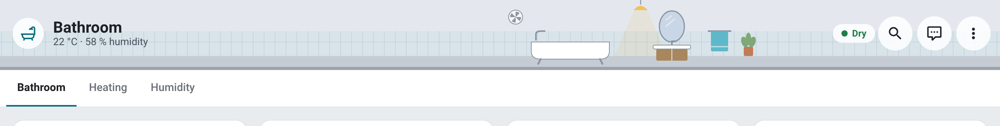 | 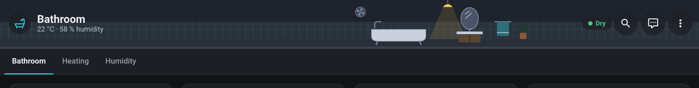 |
| 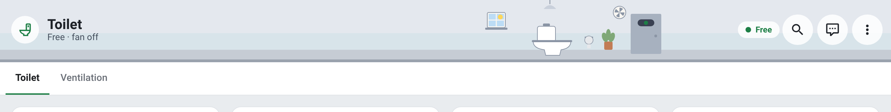 | 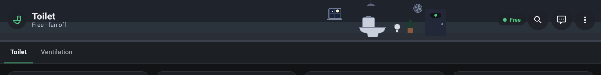 |
| 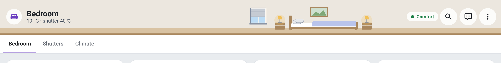 | 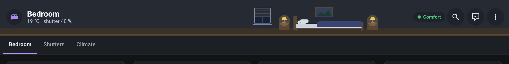 |
| 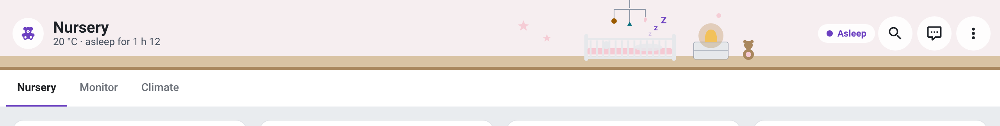 | 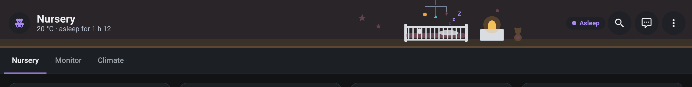 |
| 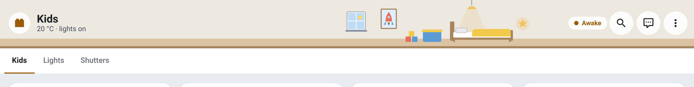 | 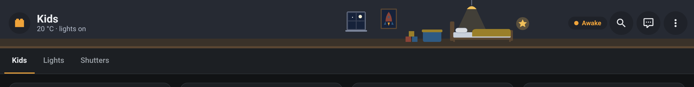 |
| 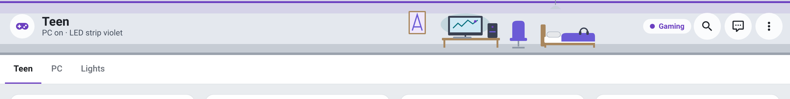 | 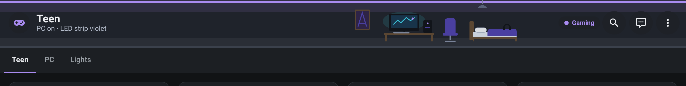 |
| 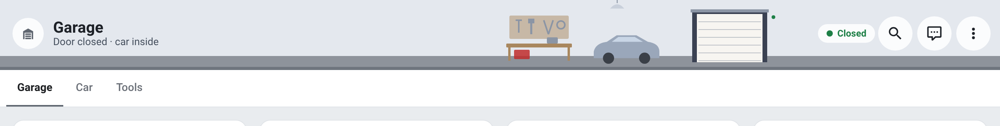 | 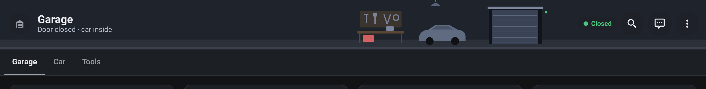 |
| 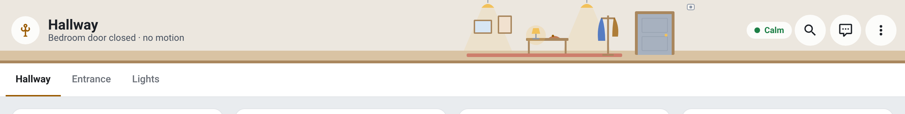 | 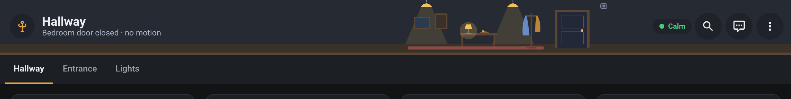 |
| 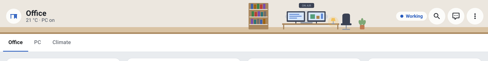 | 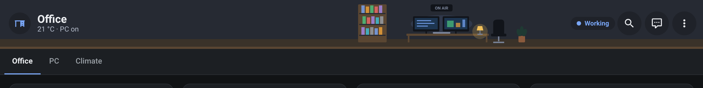 |
| 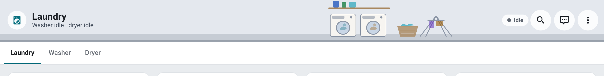 | 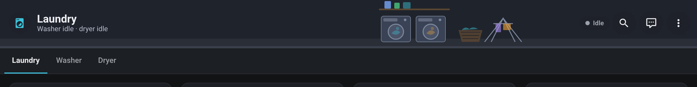 |
| 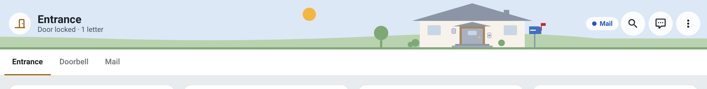 | 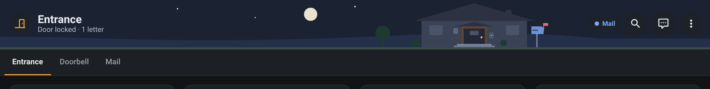 |
| 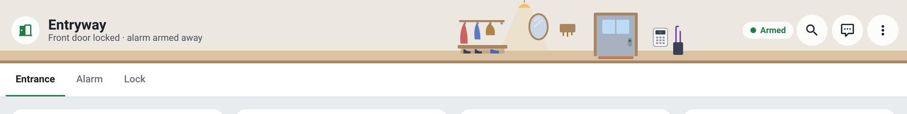 | 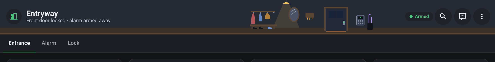 |
| 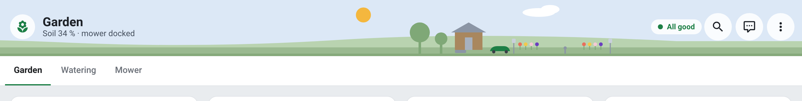 | 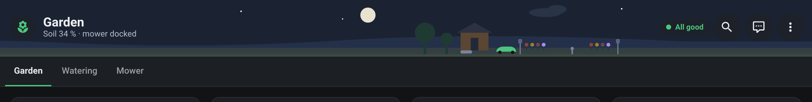 |
| 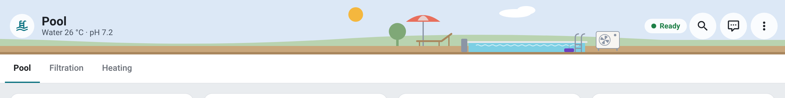 | 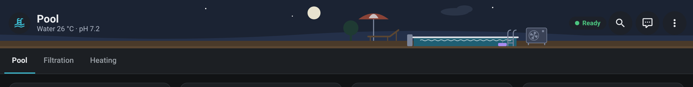 |
| 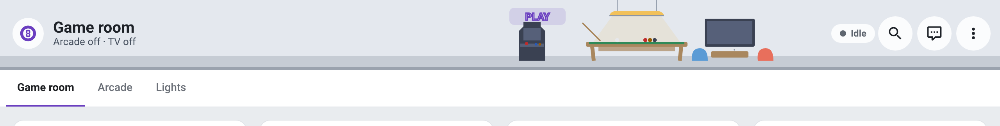 | 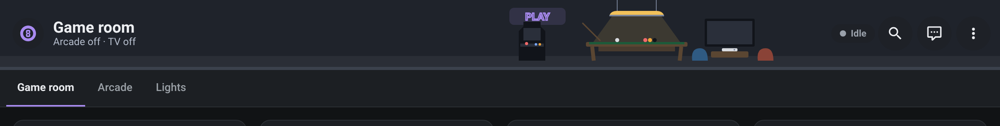 |
| 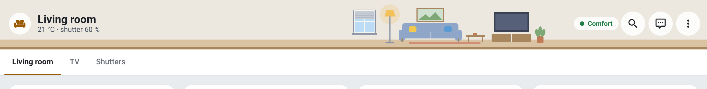 | 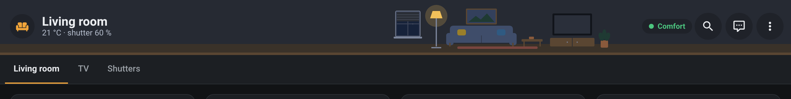 |
| 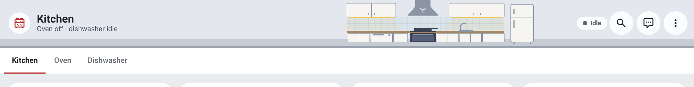 | 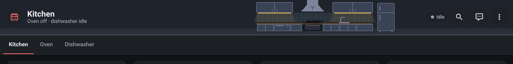 |
| 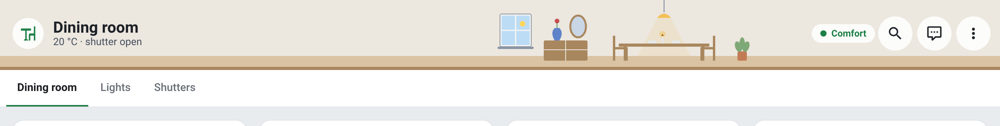 | 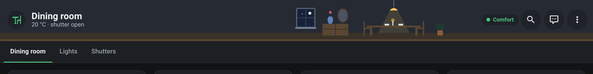 |
| 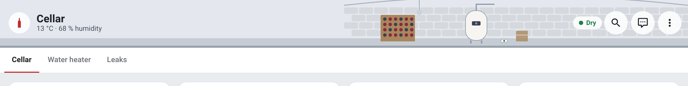 | 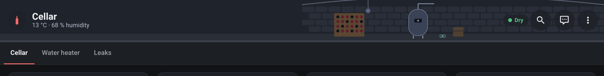 |
| 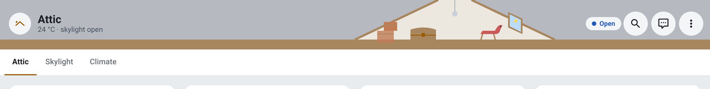 | 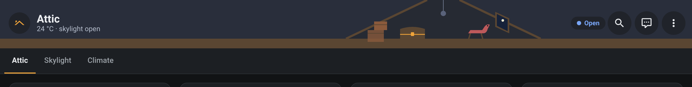 |
| 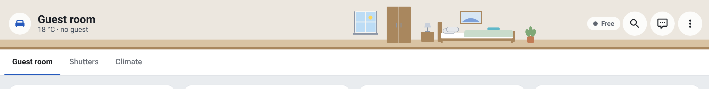 | 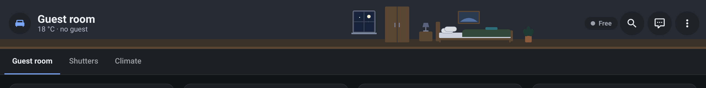 |
| 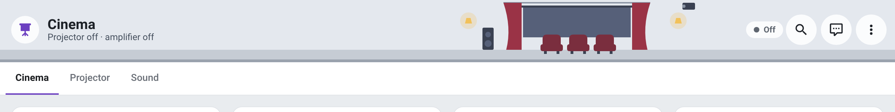 | 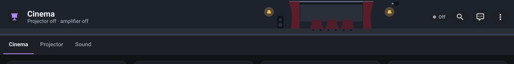 |
|  |  |
|  |  |
|  |  |

### Cars: driveway and station layouts

`layout: driveway` (one car away) and `layout: station` (prices, the car with a low tank at the pump):

| Light | Dark |
|---|---|
|  |  |
|  |  |

### Energy panel layouts

`layout: overview` and `layout: electricity` (the `now` layout is in the animations):

| Light | Dark |
|---|---|
|  |  |
|  |  |

### Compact mode and folded header

`mode: compact`, and an illustrated header folded after scrolling:

| Light | Dark |
|---|---|
|  |  |
|  |  |

### Phones

| Illustrated | Compact |
|---|---|
|  |  |
|  |  |

### Subviews

Illustrated on a computer, and `mode: auto` on a phone:

| Light | Dark |
|---|---|
|  |  |
|  |  |

### Animations

Each animated state of the scenes (still when the system asks for reduced motion):

| | Light | Dark |
|---|---|---|
| Robot vacuum cleaning, dishwasher running |  |  |
| Alarm triggered, door open |  |  |
| System warning |  |  |
| Power draw on a red Tempo day |  |  |
| Live power: grid and solar to the house |  |  |
| Rain, terrace lamp on |  |  |
| Bathroom: steam, extractor fan |  |  |
| Toilet occupied, fan on |  |  |
| Bedroom asleep, shutter down |  |  |
| Nursery: lullaby, mobile turning |  |  |
| Kids room asleep |  |  |
| Garage door opening |  |  |
| Hallway: motion, door ajar |  |  |
| Office: on air during a call |  |  |
| Washer and dryer running |  |  |
| Doorbell ringing, parcel delivered |  |  |
| Entryway: door open, alarm pending |  |  |
| Garden: watering, mower out |  |  |
| Pool: filtration, light, heat pump, cleaner |  |  |
| Game room: arcade and TV on |  |  |
| Living room: TV on |  |  |
| Kitchen: cooking, oven, hood and dishwasher |  |  |
| Cellar: leak, humidity, water heater |  |  |
| Guest room: guest asleep |  |  |
| Home cinema: projector and sound on |  |  |
| Gym: treadmill and fan on |  |  |
| Workshop: 3D printing, saw on |  |  |
| Veranda: blinds closed, fan on |  |  |

## How it works

The resource runs on every dashboard. On a dashboard whose configuration has a `dashboard_header:` block, it inserts its banner into the dashboard's header (`hui-root`) and hides the native title and tabs; the native toolbar is laid over the banner, so its buttons keep their behavior. It sets `--header-height` to the banner's height so the views start below it. Templates are rendered by Home Assistant (`render_template` subscriptions), entity states are followed live. On a subview it draws a back button that clicks Home Assistant's own (hidden) back arrow. In edit mode, on a view with `enabled: false` and on dashboards without the block, it removes itself and the native header is back. On an app panel listed under `panels:` (`ha-panel-app`), the banner is put before the app's frame, whose height is reduced by the banner's. The Energy panel (`ha-panel-energy`) renders a dashboard root of its own, with a generated configuration: its block is taken from `panels: energy:`.

Because it builds on the inside of Home Assistant's dashboard header, a frontend release that changes that header may need an update of this resource.

## Development

```sh
npm ci
npm run check          # build dist/dashboard-header.js and check its syntax
npm test               # unit tests
npm run screenshots    # README captures (needs ffmpeg and a Chromium)
```

## Translations

The few texts of the header (tab bar label) are in English, French, German, Spanish, Italian, Dutch, Portuguese, Polish, Serbian (Cyrillic and Latin), Romanian, Danish, Swedish, Bulgarian, Russian, Ukrainian, Hungarian, Slovak, Czech, Slovenian, Latvian and Greek, following Home Assistant's language.

## License

[MIT](LICENSE)

## Support

If this is useful to you, you can [buy me a coffee](https://buymeacoffee.com/julienstep9).
