# ha-dashboard-header

[](https://www.home-assistant.io/integrations/marketplace/)
[](https://github.com/juju35/ha-dashboard-header/actions/workflows/hacs.yml)
[](https://github.com/juju35/ha-dashboard-header/actions/workflows/validate.yml)
[](https://github.com/juju35/ha-dashboard-header/actions/workflows/lint.yml)
[](https://github.com/juju35/ha-dashboard-header/releases/latest)
[](https://github.com/juju35/ha-dashboard-header/blob/main/LICENSE)
[](https://buymeacoffee.com/julienstep9)

<p align="center">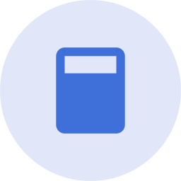</p>

**Illustrated headers for your Home Assistant dashboards**, in the style of the ha-* cards: each dashboard gets a 90 px scene (a house, devices, cars, energy, a server rack, security, family, a terrace) that follows the state of your home, with its title, a live subtitle, a status pill and calm text tabs — or a compact bar with pill tabs. Light and dark, with day and night scenes.

| Light | Dark |
|---|---|
|  | 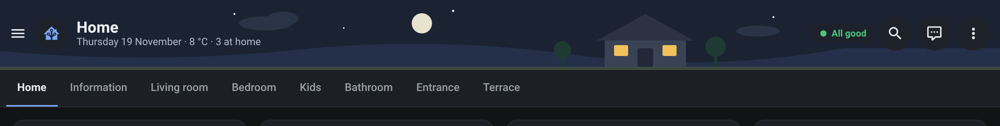 |

## Features

- **Eight scenes**, one per kind of dashboard: `maison`, `equipements`, `voitures`, `energie`, `systeme`, `securite`, `famille`, `exterieur` (English names work too: `home`, `devices`, `cars`, `energy`, `system`, `security`, `family`, `outdoor`).
- **The scene follows your home**: lit windows when the lights are on, the robot vacuum leaving its dock, the meter showing today's Tempo color, a blinking LED on the server rack, the alarm shield turning red, rain on the terrace… (`scene_state`, any entity or template).
- **Live title, subtitle and status pill** from entities or templates, rendered by Home Assistant.
- **Two modes**: `illustrated` (band + text tabs) or `compact` (one bar, pill tabs). The illustrated header **folds to the compact bar when you scroll**, and unfolds at the top.
- **Day and night**: the scene follows the Home Assistant theme (dark theme = night), or is forced with `illustration_theme`.
- **Nothing native is lost**: Home Assistant's own toolbar stays — sidebar button, search, Assist and the dashboard menu work as before, restyled as round buttons. Edit mode, subviews and dashboards without the option keep the native header.
- **Per view**: a view can change the scene, the subtitle, the status… or turn the header off.
- Phones: the scene moves under the buttons, the status becomes a dot, tabs scroll.
- Designed for the [ha-neutral](https://github.com/juju35/ha-neutral) theme, works with any theme.

## Prerequisites

Home Assistant 2025.6 or later.

## Installation

### Via the Marketplace (recommended)

Click the button below to add the repository directly:

[](https://my.home-assistant.io/redirect/marketplace_repository/?owner=juju35&repository=ha-dashboard-header&category=plugin)

Then click **Install**, and reload your browser when the Marketplace asks you to.

Or manually:

1. Open **Settings → Marketplace → Add from link** (top right; this needs a GitHub account connected)
2. Add `https://github.com/juju35/ha-dashboard-header` — Type: **Dashboard**
3. Open **Dashboard Header** and click **Install**
4. Clear your browser cache and refresh

The Marketplace adds the resource `/local/community/ha-dashboard-header/dashboard-header.js` for you.

### Manual

1. Download `dashboard-header.js` from the [latest release](https://github.com/juju35/ha-dashboard-header/releases/latest)
2. Copy it to `/config/www/`
3. Go to **Settings → Dashboards → ⋮ → Resources** → Add resource:
   - URL: `/local/dashboard-header.js`
   - Type: **JavaScript Module**
4. Clear your browser cache and refresh

## Configuration

The header is set per dashboard, at the top level of the dashboard's YAML (**Edit dashboard → ⋮ → Raw configuration editor**), next to `views:`. A dashboard without `dashboard_header:` keeps the native header.

### Minimal

```yaml
dashboard_header:
  scene: maison
views:
  - title: Home
    # …
```

### A full example

```yaml
dashboard_header:
  scene: maison
  mode: illustrated            # or compact
  collapse_on_scroll: true     # fold to the compact bar when scrolling
  title: Home                  # default: the dashboard's title
  subtitle: >-
    {{ now().strftime('%A %-d %B') }} · {{ states('sensor.outdoor_temperature') }} °C ·
    {{ states.person | selectattr('state', 'eq', 'home') | list | count }} at home
  status:
    text: "{{ 'All good' if is_state('binary_sensor.problems', 'off') else 'Check' }}"
    color: "{{ 'green' if is_state('binary_sensor.problems', 'off') else 'red' }}"
  scene_state:
    lights: light.all_lights
views:
  - title: Home
  - title: Garage
    dashboard_header:          # this view only
      scene: voitures
      scene_state:
        vehicles: [image.suv_picture, image.city_car_picture]
  - title: Terrace
    dashboard_header:
      scene: exterieur
      scene_state:
        rain: binary_sensor.rain_next_hour
        lamp: light.terrace
```

### Options reference

| Option | Default | Description |
|---|---|---|
| `scene` | `maison` | The illustration: `maison`, `equipements`, `voitures`, `energie`, `systeme`, `securite`, `famille`, `exterieur`, or `none` (band without a picture). English aliases accepted. |
| `mode` | `illustrated` | `illustrated` (90 px band and text tabs) or `compact` (64 px bar, pill tabs). |
| `collapse_on_scroll` | `true` | Illustrated mode: fold to the compact bar once the page scrolls, unfold at the top. |
| `title` | dashboard title | Text, entity id or template. |
| `subtitle` | — | Text, entity id or template. |
| `icon` | per scene | MDI icon of the badge, e.g. `mdi:home-assistant`. |
| `accent` | per scene | Badge, active tab and default status color: a palette name (`green`, `amber`, `blue`, `cyan`, `violet`, `red`, `gray`) or any CSS color. |
| `status.text` | — | Status pill text: text, entity id or template. No pill without it. |
| `status.entity` | — | Show this entity's state as the status text (instead of `status.text`). |
| `status.color` | accent | Pill color: palette name, CSS color or template. |
| `scene_state` | — | What the scene shows: see below. Each value is an entity id, a template or a literal. |
| `illustration_theme` | theme | `day` or `night` to force the scene; by default dark theme = night. |
| `enabled` | `true` | In a view's block: `false` keeps the native header on that view. |

Every option can be set again in a view's own `dashboard_header:` block; it overlays the dashboard's block (`scene_state` and `status` are merged key by key).

### Scene states

| Scene | Key | Shows |
|---|---|---|
| `maison` | `lights` | Lit windows when on. |
| `equipements` | `vacuum` | The robot leaves its dock and sweeps while `cleaning` / `returning`. |
| | `appliance` | A programme bar runs on the dishwasher when on. |
| | `printer` | The printer LED blinks red when on (an alert). |
| `voitures` | `vehicles` | The cars parked on the road, up to three: a list of picture entities (the `image.*` entity of the car's integration or of [ha-renault-picture](https://github.com/juju35/ha-renault-picture), a device tracker with a picture) or picture URLs, each drawn as the car's own picture as in [ha-vehicle-card](https://github.com/juju35/ha-vehicle-card); or a number of plain cars (default 2). An item can be an object `{ picture, home, low }`: `home` (a device tracker, a binary sensor or a template) says whether the car is at home, `low` whether its tank is low. |
| | `layout` | `road` (default), `driveway` — the cars on the driveway of the house, a car away leaves its spot empty —, or `station` — a price totem, the car with a low tank at the pump. A template can switch it (e.g. `station` when a range drops low). |
| | `prices` | Station layout: up to two prices for the totem, `{ label: entity / template / value }`, e.g. `{ Diesel: sensor.cheapest_diesel }`. |
| `energie` | `tempo` | The meter's screen in today's Tempo color (`bleu`/`blue`, `blanc`/`white`, `rouge`/`red`). |
| | `power` | The meter's bolt pulses when on. |
| `systeme` | `alert` | One rack LED blinks amber (`warning`, or any "on" state) or red (`error`, `critical`). |
| `securite` | `alarm` | The shield: green when armed, amber pending, red flashing when triggered, gray disarmed. |
| | `lock` | The door LED: green locked, amber unlocked, red open or jammed. |
| | `camera_privacy` | The camera LED turns violet when on. |
| `famille` | `school` | The school flag is up when on, down when off. |
| | `bin` | A bin in the collection's color (`jaune`/`yellow`, `vert`/`green`, `bleu`/`blue`, `marron`/`brown`, `gris`/`gray` or a CSS color); none when empty or off. |
| `exterieur` | `rain` | Rain falls from the cloud when on. |
| | `lamp` | The terrace lamp is lit when on. |

"On" means `on`, `true`, `open`, `home`, `cleaning`, `running`, `armed_*`, a number above 0…

## Screenshots

### Scenes

| Light | Dark |
|---|---|
|  | 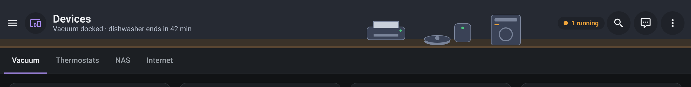 |
| 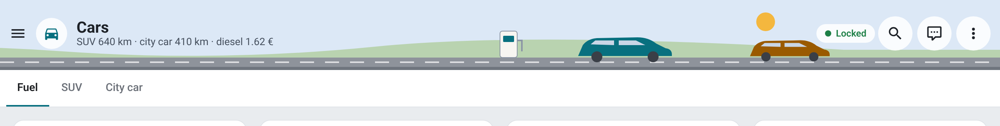 | 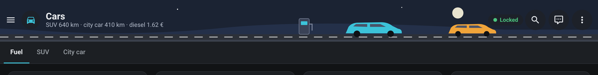 |
|  |  |
| 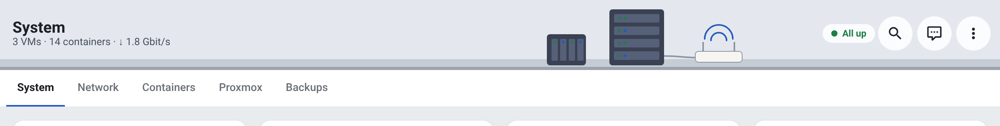 | 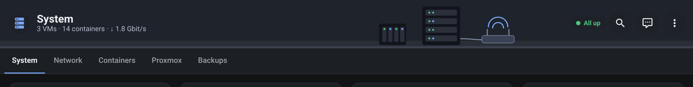 |
| 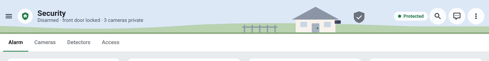 | 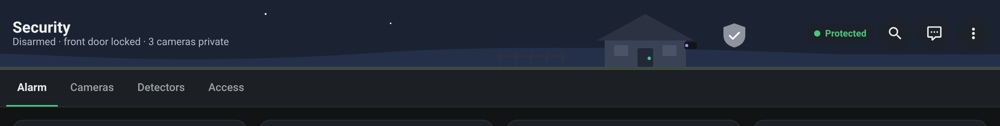 |
|  | 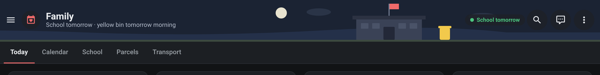 |
| 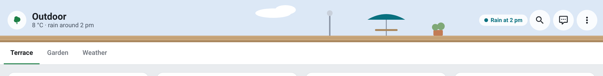 |  |

### Cars: driveway and station layouts

`layout: driveway` (one car away) and `layout: station` (prices, the car with a low tank at the pump):

| Light | Dark |
|---|---|
|  | 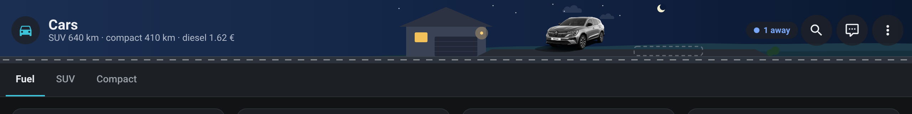 |
| 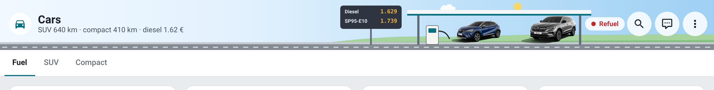 | 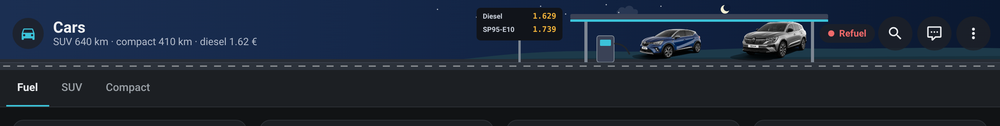 |

### Compact mode and folded header

`mode: compact`, and an illustrated header folded after scrolling:

| Light | Dark |
|---|---|
|  |  |
| 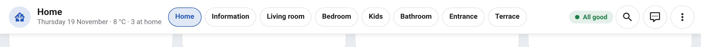 |  |

### Phones

| Illustrated | Compact |
|---|---|
|  | 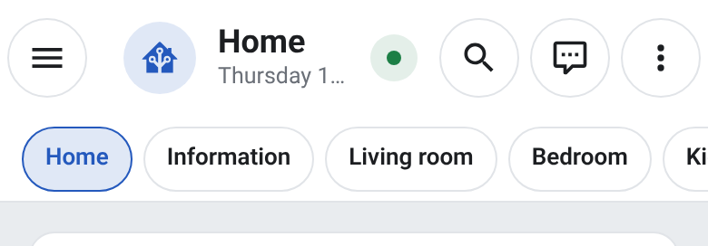 |
|  | 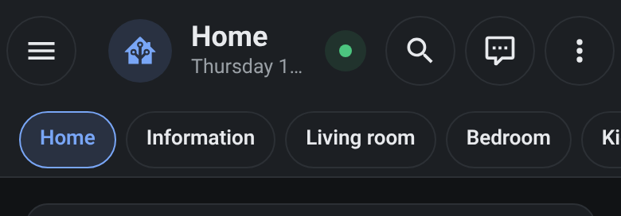 |

### Animations

Each animated state of the scenes (still when the system asks for reduced motion):

| | Light | Dark |
|---|---|---|
| Robot vacuum cleaning, dishwasher running |  | 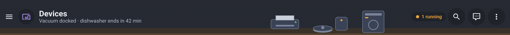 |
| Alarm triggered, door open | 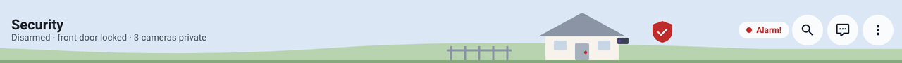 | 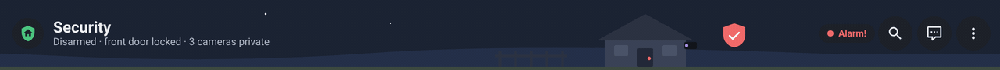 |
| System warning | 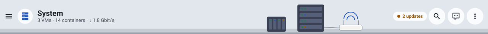 | 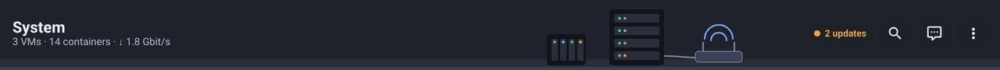 |
| Power draw on a red Tempo day |  | 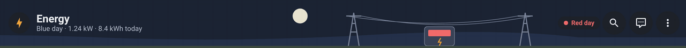 |
| Rain, terrace lamp on |  |  |

## How it works

The resource runs on every dashboard. On a dashboard whose configuration has a `dashboard_header:` block, it inserts its banner into the dashboard's header (`hui-root`) and hides the native title and tabs; the native toolbar is laid over the banner, so its buttons keep their behavior. It sets `--header-height` to the banner's height so the views start below it. Templates are rendered by Home Assistant (`render_template` subscriptions), entity states are followed live. In edit mode, on subviews, on a view with `enabled: false` and on dashboards without the block, it removes itself and the native header is back.

Because it builds on the inside of Home Assistant's dashboard header, a frontend release that changes that header may need an update of this resource.

## Development

```sh
npm ci
npm run check          # build dist/dashboard-header.js and check its syntax
npm test               # unit tests
npm run screenshots    # README captures (needs ffmpeg and a Chromium)
```

## Translations

The few texts of the header (tab bar label) are in English, French, German, Spanish, Italian, Dutch, Portuguese, Polish, Serbian (Cyrillic and Latin), Romanian, Danish, Swedish, Bulgarian, Russian, Ukrainian, Hungarian, Slovak, Czech, Slovenian, Latvian and Greek, following Home Assistant's language.

## License

[MIT](LICENSE)

## Support

If this is useful to you, you can [buy me a coffee](https://buymeacoffee.com/julienstep9).
